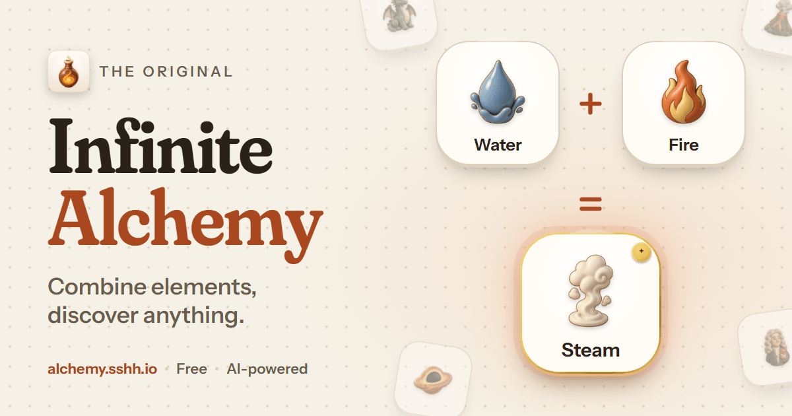

# Infinite Alchemy

**The original infinite AI alchemy game.** Drag two or more elements together and an AI decides
what you made, then paints it. Start with Earth, Water, Air, Fire and Time, and see where it goes.

**Play at [alchemy.sshh.io](https://alchemy.sshh.io).** Free, no account, works on phones.



Infinite Alchemy launched in May 2023 as one of the first AI-powered alchemy games to invent
brand-new elements on demand (originally named by GPT-4 and drawn by DALL·E). It was inspired
by [Little Alchemy](https://littlealchemy.com) by Jakub Koziol. The 2023 story is on
[the blog](https://blog.sshh.io/p/infinite-alchemy). In 2026 it was rebuilt from scratch (v2),
and everyone's progress carried over.

## How to play

- **Combine:** drag an element onto another on the workbench, or tap one and then another.
  Hold over a second element for a moment to gather it, then drop onto a third to mix up to four.
- **Discover:** every combination is decided once by the AI and then stays the same for everyone.
  If nobody has ever made what you just made, it's yours: you get a **first discovery** seal.
- **Go deep:** rarity comes from how many steps an element is from the starters. Clever,
  specific combinations can land on famous people, places, myths, characters and brands.
- **Daily challenges:** three targets every day (easy, hard, expert), always solvable with
  2-element combinations that already exist. Keep a streak going.
- **Sort by anything:** order your library in your own words ("spookiest", "things in a
  kitchen") or sort it into groups (Animals · Food · Weather). Pick **Custom…** in the sort menu,
  or press **S**.

## What's in v2

- A new interface designed for touch first: a free-form workbench, a swipeable library shelf,
  tap-to-combine, undo, search and pins, light and dark themes, and small animations throughout.
- A tuned recipe prompt (on `gpt-6-luna`) that gives the obvious answer for everyday combinations
  and a famous one when the ingredients clearly point to it. It was picked in a judged tournament
  of prompt styles over 140+ test combinations.
- A cohesive handmade-clay art style (`gpt-image-2.5-flare`). Art is generated the first time
  anyone needs it, then served from a CDN.
- No more credits or payments. It's free.
- Progress from the original game carries over automatically: your elements, your first
  discoveries, and your challenge history. Just visit in the same browser.

## How it works

| | |
|---|---|
| Frontend | Vite + React 19 SPA, Tailwind CSS v4, `motion`, a hand-rolled pointer drag engine |
| Backend | Netlify Functions v2 (`netlify/functions`) with shared modules in `server/` |
| Database | CockroachDB (schema `alchemy`), raw SQL via `pg` |
| AI | OpenAI `gpt-6-luna` (recipes, strict JSON schema) and `gpt-image-2.5-flare` (tile art); TypeSafe Jev `jev-1.14.0` (custom library sort: scores only, never text) |
| Art storage | Netlify Blobs, resized by Netlify Image CDN |

Abuse and cost controls: Netlify platform rate limits in front of the combine and image
endpoints, per-player and per-IP limits (custom sort counts every element it weighs), daily and
monthly global budgets (custom sort has its own, `JEV_DAILY_CAP`; when it runs out only custom
sorting stops), proof-of-work on new players, and ownership checks (you can only combine, or
sort, what you've discovered).

See [docs/ARCHITECTURE.md](docs/ARCHITECTURE.md) for the data model, API, and design decisions.

## Development

Requires Node 22.12+ and a `.env` with:

```
DATABASE_URL=postgresql://...      # CockroachDB
OPENAI_API_KEY=sk-...
TYPESAFE_API_KEY=...               # Jev, for custom library sort
SESSION_SECRET=<64 hex chars>      # node -e "console.log(require('crypto').randomBytes(32).toString('hex'))"
```

Production needs the same keys in the Netlify site environment (Functions scope), including
`TYPESAFE_API_KEY`.

```bash
npm install
npm run db:migrate                                   # create/upgrade the schema (idempotent)
AI_MODE=mock DB_SCHEMA=alchemy_e2e npm run db:seed-e2e # a small local world
AI_MODE=mock DB_SCHEMA=alchemy_e2e npm run dev       # app + functions at http://localhost:8888
```

`AI_MODE=mock` swaps in a deterministic, offline AI (recipes, art and custom sorting) so local
play and tests cost nothing. `npx tsx scripts/jev-smoke.ts` is a manual, live check of the Jev
client (a fraction of a cent). Before changing any custom-sort question, the Jev model pin or
`SORT_RUBRIC`, run `npm run eval:sort` (live, labelled cases; cached reruns are free, a full
uncached run is about $0.08).

| Command | |
|---|---|
| `npm run typecheck` | TypeScript |
| `npm test` | Unit tests (Vitest) |
| `npm run e2e` | Playwright across desktop, Pixel, iPhone, iPad and WebKit, including a returning-player journey from the 2023 app ([e2e/README.md](e2e/README.md)) |
| `npm run build` | Production build |
| `npm run eval:sort` | Custom-sort quality eval against live Jev (`--split tune\|holdout`, `--offline`, `--budget-usd`) |

### Migrating from the 2023 version

The original tables are left untouched. The v2 tables live in their own schema, and the
backfill is idempotent, so it is safe to re-run:

```bash
npm run db:migrate      # schema
npm run db:backfill     # legacy elements, recipes, players, completions, challenge history
npm run db:challenges   # daily challenges from 2026-11-06 for five years
npm run db:enrich       # emoji + display casing for legacy elements
```

Players' discovered elements lived in browser storage in the old app. On their first visit to
v2 the client sends them once to be restored. A tiny replacement `service-worker.js` retires the
old app's offline cache so returning players land on the new game.

## Other versions of the game

Infinite Alchemy is one of a long line of element-combining games. Some well-known ones:

| Game | Creator | Year | How results are made | Platforms |
|---|---|---|---|---|
| [Doodle God](https://apps.apple.com/us/app/doodle-god/id376374689) | JoyBits | 2010 | Hand-made | iOS, Android, PC, consoles |
| [Little Alchemy](https://littlealchemy.com) (our inspiration) | Jakub Koziol (Recloak) | 2010 | Hand-made | Web, iOS, Android |
| [Elemental 3](https://htwins.net/elem3/) | Cary Huang | 2016 | Crowd-voted (players suggested and voted on results; ended 2020) | Web |
| [Little Alchemy 2](https://littlealchemy2.com) | Jakub Koziol (Recloak) | 2017 | Hand-made | Web, iOS, Android |
| **Infinite Alchemy** (this repo) | Shrivu Shankar | **2023** | AI (an LLM names each element, an image model draws it) | Web |
| [Alchemy AI – Infinite Elements](https://apps.apple.com/us/app/alchemy-ai-infinite-elements/id6466730288) | HostAIle Games | 2023 | AI | iOS, Android |
| [Allchemy](https://allchemy.io) | Allchemy team | 2024 | AI | Web |
| [Infinite Craft](https://neal.fun/infinite-craft/) | Neal Agarwal | 2024 | AI (Llama 2) | Web, iOS, Android |
| [OpenCraft](https://github.com/bufferhead-code/opencraft) | bufferhead | 2024 | AI (open-source, local model) | Web (self-hosted) |

The genre goes back further still, for example to a 1990s MS-DOS game called *Alchemy*.
Not to be confused with later, unrelated games also called "Infinite Alchemy".

## License

[MIT](LICENSE)
